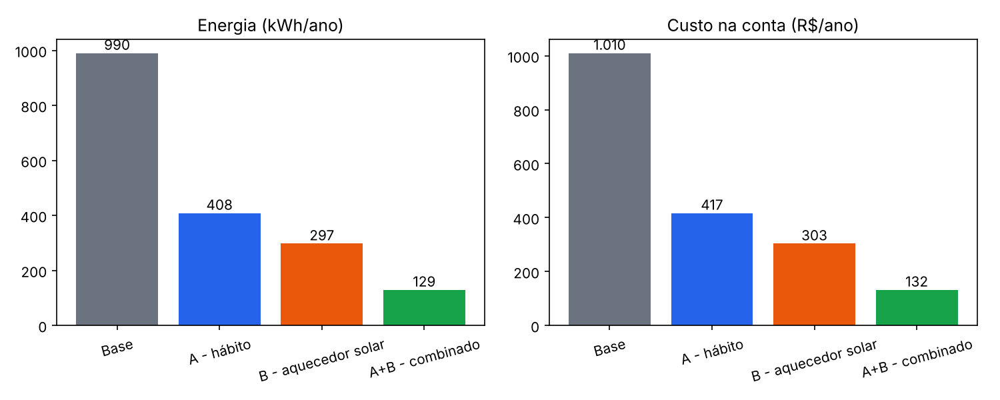

# Citizen Assist AI: energia no banho
### Contribuição da disciplina **Soluções em Energias Renováveis e Sustentáveis** (Global Solution 2026.2, 1CC)

## Integrantes
| Nome completo | RM |
|---|---|
| Leonardo Takachi | RM:569066 |
| Giovane Salazar | RM:570396 |

**Vídeo (YouTube, não listado):** _[LINK DO VÍDEO]_

---

## Público e problema
**Público:** famílias de baixa renda atendidas pela Central do Cidadão, o mesmo público do Citizen Assist AI.
**Necessidade energética:** aquecer a água do banho. O chuveiro elétrico é um dos aparelhos de maior potência da casa (5.500 W), é usado todos os dias por todos os moradores e costuma ligar no fim da tarde, no horário de pico.
**Pergunta que respondemos:** *"Quanto o banho pesa na minha conta de luz e o que eu posso fazer para pagar menos?"*

Comparamos, para a **mesma necessidade** (família de 3 pessoas em São Paulo) e o **mesmo período** (12 meses):

| | Cenário | Tipo |
|---|---|---|
| Base | Banho de 10 min, chuveiro na posição inverno o ano todo | situação atual |
| **A** | Banho de até 5 min e posição verão de outubro a março | economia de energia, custo zero |
| **B** | Aquecedor solar de água (termossifão, 150 a 200 L) com o chuveiro só de apoio | **fonte renovável** |

Detalhes em [`01_contexto.md`](01_contexto.md).

## Resultados
| 3 pessoas, 12 meses | Energia | Conta do banho | Economia | Investimento | Tempo de retorno | CO₂ evitado |
|---|---|---|---|---|---|---|
| Base | 990 kWh | ~R$ 1.010 | — | — | — | — |
| A: hábito | 408 kWh | ~R$ 417 | **59%** (~R$ 593/ano) | R$ 0 | imediato | 22 kg |
| B: aquecedor solar | 297 kWh | ~R$ 303 | **70%** (~R$ 706/ano) | R$ 2.300 a 4.300 | 3,3 a 6,1 anos | 27 kg |
| A + B | 129 kWh | ~R$ 132 | 87% (~R$ 878/ano) | R$ 2.300 a 4.300 | 8,1 a 15,1 anos* | 33 kg |

\* Tempo para o aquecedor se pagar **depois** que a família já mudou o hábito.



**Principais conclusões:**
1. **A mudança de hábito dá quase a mesma economia que o aquecedor solar, sem custo.** Por isso é a primeira recomendação.
2. **O aquecedor solar se paga em 3 a 6 anos**, dentro da vida útil dos coletores (15 a 25 anos). Mas só é viável para quem tem casa própria, telhado adequado e dinheiro ou crédito.
3. **Para quem já toma banho curto, o aquecedor rende pouco a mais** (~R$ 285/ano) e leva de 8 a 15 anos para se pagar.
4. **Tarifa Social (Lei 15.235/2025):** a energia é gratuita até 80 kWh/mês para famílias de baixa renda no CadÚnico. Como só o banho já passa disso, economizar continua reduzindo a conta.
5. **Impacto ambiental:** o CO₂ evitado é pequeno, porque a eletricidade brasileira é majoritariamente renovável. O ganho maior é reduzir o consumo **no horário de pico** e, com a alternativa A, economizar ~21 mil litros de água por ano.

Comparação completa (custo, viabilidade e impacto ambiental), recomendação e limitações: [`04_comparacao_e_recomendacoes.md`](04_comparacao_e_recomendacoes.md).

## Funcionalidades de energia no assistente
O assistente responde por **menu numérico** ou **pergunta livre**, só pelo teclado:

| Opção | O que faz |
|---|---|
| 1 | Calcula o gasto do banho **da casa do usuário** (pede só minutos de banho e número de pessoas) e mostra quanto ele pode economizar |
| 2 | Dicas que não custam nada: banho curto e posição verão |
| 3 | Diz se o aquecedor solar vale a pena, e para quem. Se o usuário já fez o cálculo, usa os números da casa dele |
| 4 | Explica a Tarifa Social e onde procurar (distribuidora e CRAS) |
| 5 | Impacto ambiental |
| 6 | Fontes e limitações |

Também entende "minha conta de luz está cara", "moro de aluguel", números por extenso ("doze minutos") e perguntas fora do assunto (fotovoltaica, gás, geladeira), que recebem "essa análise não cobre", sem inventar valores.

**Exemplo:**
```
Você: banho de 12 minutos, somos 4

Assistente:
Sua casa: 4 pessoas, banho de 12 minutos.

GASTO HOJE: cerca de R$ 135 por mês só com o banho.
VOCÊ PODE ECONOMIZAR: cerca de R$ 88 por mês, sem gastar nada.
Como: banho de até 5 minutos e chave na posição verão nos meses quentes.
...
ATENÇÃO: os valores são estimativas, não são garantidos.
ATENÇÃO: este assistente NÃO é um canal oficial. Confirme com a sua distribuidora de energia.
Fonte: ficha FC-08, verificada em 13/11/2026.
```
Conversa completa em [`testes/demo_conversa.txt`](testes/demo_conversa.txt).

**Como a análise sustenta as respostas:** o notebook e o assistente usam o **mesmo** módulo de cálculo ([`calculadora_energia.py`](calculadora_energia.py)), que lê as premissas de [`dados/premissas.csv`](dados/premissas.csv). Um teste automático confere que os valores do assistente são iguais aos salvos pelo notebook. O texto das respostas vem da ficha [`fichas/FC-08_energia_banho.md`](fichas/FC-08_energia_banho.md), no mesmo formato das fichas FC-01 a FC-07 do Citizen Assist AI.

**Privacidade e segurança:** o assistente nunca pede CPF, NIS, renda, endereço ou conta de luz. CPF, telefone e e-mail digitados são removidos antes do processamento, com aviso ao usuário, e nada é guardado. Tentativas de "nova regra" ou de ver as instruções internas são recusadas.

Por que esta parte usa regras, e não um LLM, e como ela se encaixa no assistente completo: [`05_integracao_assistente.md`](05_integracao_assistente.md).

## Como executar e testar
Requisitos: **Python 3.10+**. No terminal, **dentro da pasta `energia/`**:

```bash
pip install -r requirements.txt

python assistente_energia.py        # conversa com o assistente (digite 0 para sair)
python -m pytest testes -v          # 27 testes automáticos
jupyter notebook 03_calculos.ipynb  # análise completa (já executada, com gráficos)
```

Se mudar algum valor em `dados/premissas.csv`, rode o notebook de novo (**Kernel → Restart & Run All**) e depois os testes.

## Dados, cálculos e fontes
| Conteúdo | Arquivo |
|---|---|
| 27 premissas com valor, unidade, tipo (oficial, secundária, estimado, premissa) e fonte | [`dados/premissas.csv`](dados/premissas.csv) |
| Origem dos dados, conceitos e o que conferir | [`02_dados_e_fontes.md`](02_dados_e_fontes.md) |
| Cálculos: energia por banho, conferência física (Q = m·c·ΔT), consumo mês a mês, payback, Tarifa Social, sensibilidade | [`03_calculos.ipynb`](03_calculos.ipynb) |
| Resultados exportados | [`resultados/`](resultados/) |
| Gráficos | [`figuras/`](figuras/) |

**Principais premissas:** chuveiro de 5.500 W; tarifa Enel SP estimada em R$ 1,02/kWh com impostos; fração solar de 70% (NBR 15569), que varia de 58% no inverno a 82% no verão; aquecedor de R$ 2.300 a R$ 4.300; fator de emissão de 0,0385 t CO₂/MWh (MCTI, 2023). Dados de **São Paulo**, porque a cidade de Aurora das fichas é fictícia.

## Testes com usuários
5 participantes de fora do grupo, anônimos (P1 a P5), fizeram 3 tarefas com casas fictícias. Médias: "fácil de usar" 4,0/5, "dicas úteis" 4,0/5, "indicaria" 4,4/5. A nota mais baixa foi "entendi sem ajuda" (3,4/5), por problemas na forma de mostrar os números. Isso gerou **8 ajustes** no assistente, cada um com teste automático.

| Arquivo | Conteúdo |
|---|---|
| [`06_testes_com_usuarios.md`](06_testes_com_usuarios.md) | Relatório: situações testadas, resultados, comentários, ajustes e limitações |
| [`testes_usuarios/registro_ajustes.md`](testes_usuarios/registro_ajustes.md) | Cada problema ligado ao ajuste feito |
| [`testes_usuarios/antes_depois.md`](testes_usuarios/antes_depois.md) | Respostas antes e depois dos ajustes |
| [`testes_usuarios/`](testes_usuarios/) | Roteiro, planilhas e script de análise |

## Limitações
- Os valores são **estimativas** com médias (potência, tempo de banho, tarifa). O chuveiro, os hábitos e a distribuidora de cada casa mudam o resultado.
- A tarifa não inclui bandeira tarifária nem iluminação pública. O payback é simples, sem juros, reajuste ou manutenção.
- Algumas fontes são secundárias ou antigas (irradiação do Atlas INPE de 2006; fator de emissão de 2023). Elas estão marcadas em `02_dados_e_fontes.md`.
- O benefício de reduzir o consumo no horário de pico foi discutido, mas não quantificado.
- Fora do escopo: dimensionamento técnico do aquecedor, placas fotovoltaicas, gás e outros aparelhos.
- Os testes com usuários tiveram 5 participantes por conveniência, e o reteste depois dos ajustes ainda não foi feito.
- **O assistente é um protótipo educacional, não um canal oficial.**

## Referências
- IBGE, Censo 2022: moradores por domicílio, via [Metrópoles, 28/06/2023](https://www.metropoles.com/brasil/familias-encolhem-em-media-ha-menos-de-3-pessoas-por-domicilio)
- [Câmara dos Deputados: Lei 15.235/2025 (Tarifa Social)](https://www.camara.leg.br/noticias/1209764-entra-em-vigor-lei-que-estabelece-conta-de-luz-gratuita-para-familias-de-baixa-renda/)
- [Enel SP: Tarifa Social Baixa Renda](https://www.enel.com.br/pt-saopaulo/Para_Voce/Tarifa_Social_Baixa_Renda.html)
- [Valor do kWh da Enel SP em 2026 (cita ANEEL REH 3.596/2026)](https://calculakwh.com.br/artigos/valor-do-kwh-enel-sp/)
- [MCTI/SIRENE: fatores de emissão](https://www.gov.br/mcti/pt-br/acompanhe-o-mcti/sirene/dados-e-ferramentas/fatores-de-emissao), valor de 2023 via [eixos](https://eixos.com.br/energia-eletrica/brasil-tem-menor-taxa-de-emissao-de-carbono-na-geracao-eletrica-em-onze-anos/)
- [Chagas, PUC-Rio (2015): hábitos de banho e consumo do chuveiro elétrico](https://www.maxwell.vrac.puc-rio.br/25584/25584.PDF)
- [Altoé, Oliveira Filho e Carlo (2012), Ambiente Construído: aquecimento solar e NBR 15569](https://seer.ufrgs.br/ambienteconstruido/article/download/25706/21162)
- [Idec: economia com aquecedor solar](https://idec.org.br/dicas-e-direitos/economia-com-aquecedor-solar)
- [Cronoshare: preço de aquecedor solar termossifão (2026)](https://www.cronoshare.com.br/quanto-custa/instalar-aquecedor-solar-agua-termossifao)
- [Energia Solar Paulista, SEE-SP (2013): irradiação em São Paulo (Atlas INPE)](https://www.absolar.org.br/wp-content/uploads/2021/02/S%C3%A3o%20Paulo.pdf)

Lista completa em [`02_dados_e_fontes.md`](02_dados_e_fontes.md).
